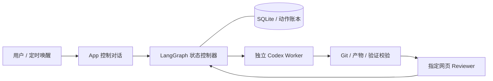

# Long Workflow Agent

一个面向长期分阶段项目的 Agent 运行系统：LangGraph/SQLite 保存状态，独立可见的
Codex Worker 实施，指定的原 ChatGPT 网页 Reviewer 审核，原生定时任务负责唤醒。

原来的 long-workflow skill 已迁移为运行时。`skills/long-workflow` 保留轻量 App 入口；
阶段顺序、版本绑定、预算、动作账本和暂停门禁由 Python 强制执行。



## 使用

要求 Python 3.11+、Git、可用的 App 工具与浏览器连接。先安装本地运行时：

```powershell
python -m venv .venv
.venv\Scripts\python.exe -m pip install -e ".[dev]"
```

复制 `examples/project_config.yaml`，填入已批准的 Proposal、Batch、项目仓库、
用户选择的模型和原 Reviewer 对话。安装 `skills/long-workflow`，配置本地 runtime 位置后：

```text
使用 $long-workflow，按 <配置文件绝对路径> 启动项目，run_id 为 example-run。
暂停 example-run。
恢复 example-run。
查看 example-run 的进度。
```

暂停先阻止新派发和推进，再等待真实 Worker 收尾确认。恢复同一 attempt 的原 Worker。
定时唤醒和 App 重启只读取持久化状态，不能授权解除人类暂停。
本机定时执行需要 App 运行；关闭期间不执行，重新打开后由下一次投递接回。

[运行和恢复说明](docs/operations.md) · [验收范围](docs/acceptance.md) · [发布脱敏](docs/privacy.md)

## 本地验证

```powershell
.venv\Scripts\python.exe -m pytest -q
.venv\Scripts\python.exe -m ruff check orchestrator tests scripts
.venv\Scripts\python.exe -m orchestrator demo --directory .runs/example-demo
```

`demo` 使用真实 Git 和 SQLite、模拟参与者，与真实 App/浏览器验收严格分开。
真实小项目生成器 `scripts/prepare_live_smoke.py` 要求显式提供 Reviewer URL，并拒绝覆盖目录。
运行数据、原始审核回复、实际 ID、截图与本机路径不随源码发布。

## 文件分工

| 位置 | 作用 |
|---|---|
| `orchestrator/graph.py` | 合法状态转移、验收门禁与 Batch 推进 |
| `orchestrator/lifecycle.py` | 暂停、停止确认、同一 Worker 恢复 |
| `orchestrator/runtime.py` | 持久化运行、唤醒、核对和项目互斥 |
| `orchestrator/bridge.py` | 下一步宿主操作、完整审核证据和回执解析 |
| `orchestrator/store.py` | 动作和控制消息的 intent/claim/receipt 账本 |
| `orchestrator/git.py` | checkout、remote、产物及提交一致性 |
| `skills/long-workflow/` | App 入口及宿主桥接协议 |
| `tests/` | 真实 Git/SQLite 的状态和故障回归测试 |

## 当前边界

- 平台动作依赖 App 控制对话；普通 Python 进程不能直接调用 App 宿主工具。
- 控制对话和 Worker 使用订阅额度；LangChain 可选异常建议接口未连接真实模型。
- 暂停是协作式收尾，运行时锁不约束任意外部写入者。
- 暂停快照覆盖 Git 与非 ignored 文件；独立大数据 lineage 尚未接入。
- 完整文本审核包上限 240 KB；二进制和文件删除的审核证据暂未适配，遇到时阻断。
- 不自动绕过预算、变更批准范围、切换 Reviewer 或修改系统权限。
- 本轮 App 退出/重启验收由用户取消，未验证；已实测的是 App 保持运行时的真实定时唤醒与暂停门禁。
